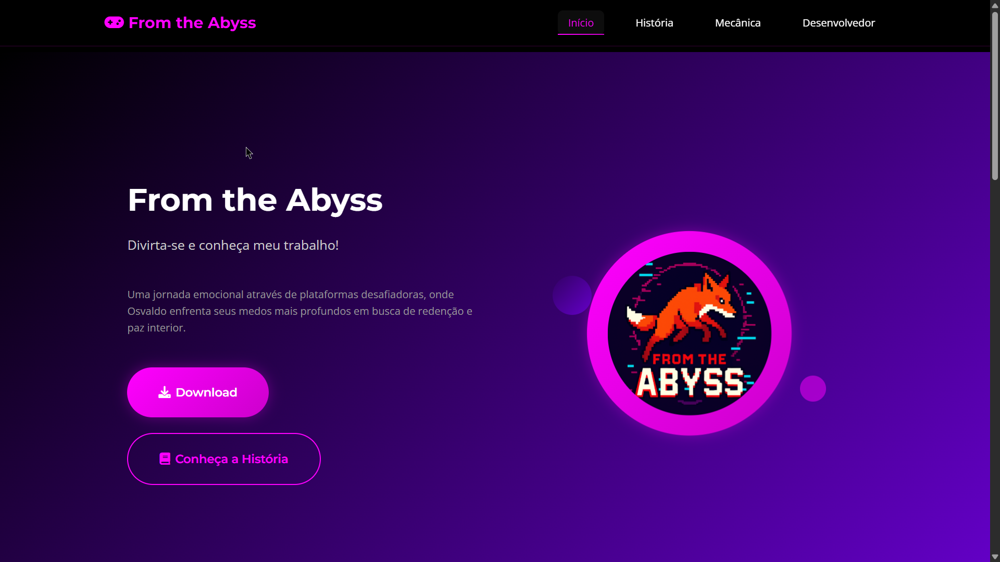

# 🌐 From the Abyss — Portal Web Oficial



> **Status:** Online em produção | **Repositório do Jogo (Unity 2D / C#):** [From-The-Abyss](https://github.com/EduardoBruscagim/From-The-Abyss)

---

## 📜 Sobre o Projeto

Este repositório contém o portal web oficial de apresentação, documentação de mecânicas e distribuição do jogo indie 2D **From the Abyss** (Projeto de TCC).

O projeto foi desenvolvido utilizando uma arquitetura **Multi-Page Application (MPA)** responsiva com **HTML5 semântico, CSS3 moderno (Design Tokens em `:root`, Grid e Flexbox)** e **Vanilla JavaScript (ES6+)**, sem dependência de frameworks pesados para garantir carregamento imediato e controle direto sobre o DOM.

---

## 🔗 Demonstração em Produção

👉 **[Acesse: from-the-abyss.vercel.app](https://from-the-abyss.vercel.app/)**

---

## ⚙️ Arquitetura e Funcionalidades

- **Páginas Dedicadas (MPA):**
  - `index.html`: Landing page principal com trailer/apresentação visual, destaques e chamada para download.
  - `historia.html`: Narrativa interativa estruturada em componentes *Accordion* (`assets/js/accordion.js`) com indicador de progresso de leitura por capítulos.
  - `mecanica.html`: Documentação visual dos controles, sistema de física, armadilhas e colecionáveis do jogo.
  - `desenvolvedor.html`: Ficha técnica do projeto, stack de desenvolvimento e canais de contato com cópia rápida para a área de transferência (`navigator.clipboard`).
- **CSS Architecture (`assets/css/style.css`):**
  - Sistema de variáveis CSS (`:root`) para paleta de cores inspirada na atmosfera de caverna/abismo, tipografia e espaçamentos modulares.
  - Layouts fluidos em **CSS Grid** e **Flexbox** com *breakpoints* responsivos para dispositivos móveis, tablets e desktops.
- **JavaScript (ES6+):**
  - Controle de navegação responsiva com suporte a fechamento por teclado (`Escape`).
  - Destaque dinâmico de seção ativa com *debounce* no evento de *scroll* (`assets/js/main.js`).
  - Componentes *Accordion* interativos para exploração de capítulos da história (`assets/js/accordion.js`).

---

## 🛠️ Tecnologias Utilizadas

- **Marcação:** HTML5 Semântico
- **Estilização:** CSS3 (Custom Properties, Grid, Flexbox, Keyframe Animations)
- **Scripting:** JavaScript ES6+
- **Tipografia & Ícones:** Google Fonts & Font Awesome 6
- **Deploy:** Vercel

---

## 🗂️ Estrutura de Arquivos

```text
Site-From-The-Abyss/
├── index.html              # Landing Page principal (Início)
├── historia.html           # Lore e narrativa em componentes Accordion
├── mecanica.html           # Guia de controles, física e mecânicas do jogo
├── desenvolvedor.html      # Créditos, ficha técnica e contato
└── assets/
    ├── css/
    │   └── style.css       # Design system, variáveis e responsividade
    ├── js/
    │   ├── main.js         # Navegação, scroll debounced e micro-interações
    │   └── accordion.js    # Controle de capítulos e barra de progresso
    └── images/             # Capturas de tela, sprites e backgrounds
```

---

## 👨‍💻 Autor

Desenvolvido por **Eduardo Guilherme Bruscagim** — [@EduardoBruscagim](https://github.com/EduardoBruscagim)
